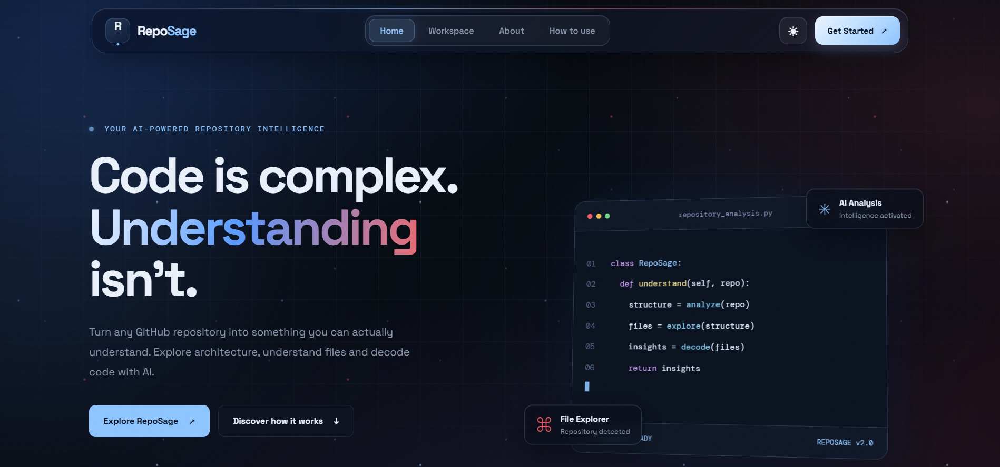
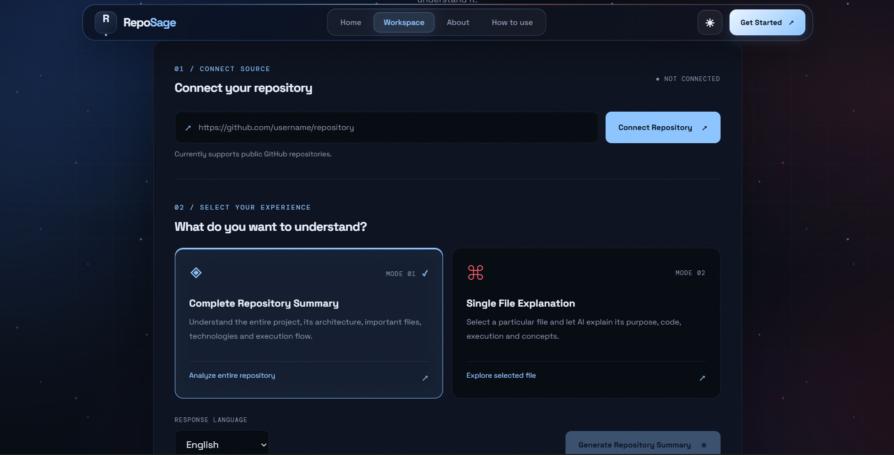

```text 


██████╗ ███████╗██████╗  ██████╗ ███████╗ █████╗  ██████╗ ███████╗
██╔══██╗██╔════╝██╔══██╗██╔═══██╗██╔════╝██╔══██╗██╔════╝ ██╔════╝
██████╔╝█████╗  ██████╔╝██║   ██║███████╗███████║██║  ███╗█████╗
██╔══██╗██╔══╝  ██╔═══╝ ██║   ██║╚════██║██╔══██║██║   ██║██╔══╝
██║  ██║███████╗██║     ╚██████╔╝███████║██║  ██║╚██████╔╝███████╗
╚═╝  ╚═╝╚══════╝╚═╝      ╚═════╝ ╚══════╝╚═╝  ╚═╝ ╚═════╝ ╚══════╝
```

<div align="center">

### REPOSITORY INTELLIGENCE • POWERED BY AI

**Turn unfamiliar codebases into understandable systems.**

*Explore repositories. Decode files. Understand architecture.*

[](https://python.org)
[](https://fastapi.tiangolo.com/)
[](https://ai.google.dev/)
[](https://docs.github.com/en/rest)

`DECODE THE UNKNOWN. UNDERSTAND THE SYSTEM.`

</div>

---

## 01 — THE PROJECT

**What if understanding a GitHub repository was as simple as pasting its URL?**

RΞPOSAGE is an AI-powered GitHub Repository Intelligence Platform built to help developers understand unfamiliar codebases without manually navigating hundreds of files.

Connect a public repository, explore its structure, select your preferred analysis mode, and receive structured AI-generated explanations.

## 02 — PLATFORM PREVIEW

### ◈ Home — The Intelligence Hub

The central landing experience introduces RepoSage, its capabilities, and the repository exploration workspace.

<div align="center">




---




*The RepoSage landing page — introducing the repository intelligence experience.*

</div>

### ◈ Workspace — Where Understanding Begins

Connect a GitHub repository and choose between complete repository analysis and individual file explanation.

<div align="center">


*Repository connection and analysis mode selection.*

</div>

## 03 — INTELLIGENCE MODULES

| MODULE | CAPABILITY |
|:--|:--|
| Repository Scanner | Fetch repository metadata and recursive file structure |
| File Explorer | Organize and categorize repository files |
| File Intelligence | Explain selected files, functions, classes and logic |
| Repository Intelligence | Generate a structured repository overview |
| AI Explanation Engine | Convert complex code into beginner-friendly explanations |

### MODE 01 — COMPLETE REPOSITORY SUMMARY

Understand the entire project through:

- Project purpose and overview
- Folder and file organization
- Technologies and dependencies
- Important files and their responsibilities
- Architecture and execution flow

### MODE 02 — SINGLE FILE EXPLANATION

Explore any selected file through:

- File purpose and responsibilities
- Important functions and classes
- Internal code logic
- Concepts used in the implementation
- Connections with other files

## 04 — THE REPOSAGE PIPELINE

<div align="center">

### FROM REPOSITORY URL TO CODE INTELLIGENCE

</div>

```text
                 ┌──────────────────────────────────┐
                 │                                  │
                 │          USER INPUT              │
                 │                                  │
                 │      GitHub Repository URL       │
                 │                                  │
                 └────────────────┬─────────────────┘
                                  │
                                  ▼
                 ┌──────────────────────────────────┐
                 │                                  │
                 │         URL VALIDATION           │
                 │                                  │
                 │     Extract Owner & Repository   │
                 │                                  │
                 └────────────────┬─────────────────┘
                                  │
                                  ▼
                 ┌──────────────────────────────────┐
                 │                                  │
                 │       GITHUB INTEGRATION         │
                 │                                  │
                 │     Repository Metadata          │
                 │     Recursive File Tree          │
                 │                                  │
                 └────────────────┬─────────────────┘
                                  │
                                  ▼
                 ┌──────────────────────────────────┐
                 │                                  │
                 │        FILE PROCESSING           │
                 │                                  │
                 │      File Categorization         │
                 │      Content Retrieval           │
                 │                                  │
                 └────────────────┬─────────────────┘
                                  │
                                  ▼
                 ┌──────────────────────────────────┐
                 │                                  │
                 │         ANALYSIS MODE            │
                 │                                  │
                 │      Choose Your Experience      │
                 │                                  │
                 └────────────────┬─────────────────┘
                                  │
                    ┌─────────────┴─────────────┐
                    │                           │
                    ▼                           ▼
       ┌────────────────────────┐  ┌────────────────────────┐
       │                        │  │                        │
       │    FILE INTELLIGENCE   │  │ REPOSITORY INTELLIGENCE│
       │                        │  │                        │
       │   Selected File        │  │   Complete Codebase    │
       │   Functions & Classes  │  │   Project Structure    │
       │   Internal Logic       │  │   Architecture & Flow  │
       │                        │  │                        │
       └────────────┬───────────┘  └────────────┬───────────┘
                    │                           │
                    └─────────────┬─────────────┘
                                  │
                                  ▼
                 ┌──────────────────────────────────┐
                 │                                  │
                 │           AI ENGINE              │
                 │                                  │
                 │        Google Gemini             │
                 │     Contextual Processing        │
                 │                                  │
                 └────────────────┬─────────────────┘
                                  │
                                  ▼
                 ┌──────────────────────────────────┐
                 │                                  │
                 │       INTELLIGENT OUTPUT         │
                 │                                  │
                 │    Structured Explanations       │
                 │    Beginner-Friendly Insights    │
                 │                                  │
                 └──────────────────────────────────┘
```

<div align="center">

**INPUT → INGESTION → PROCESSING → INTELLIGENCE → UNDERSTANDING**

</div>

### Pipeline Breakdown

| STAGE | PROCESS |
|:--|:--|
| 01 | Receive and validate GitHub URL |
| 02 | Extract repository metadata and file tree |
| 03 | Categorize files and retrieve content |
| 04 | Select file-level or repository-level analysis |
| 05 | Process relevant context through Gemini |
| 06 | Generate structured explanations |
| 07 | Present understandable code insights |

### Pipeline Breakdown

| STAGE | PROCESS |
|:--|:--|
| 01. Input | User submits a GitHub repository URL |
| 02. Validation | Extract and validate repository owner and name |
| 03. Integration | Fetch metadata and recursive file tree |
| 04. Processing | Categorize files and retrieve relevant content |
| 05. Selection | Choose repository summary or single-file analysis |
| 06. AI Processing | Send relevant context for Gemini-powered explanation |
| 07. Output | Return structured, beginner-friendly results |

## 05 — SYSTEM ARCHITECTURE

```text
             ┌──────────────────────────┐
             │       USER BROWSER       │
             └────────────┬─────────────┘
                          │
                          ▼
             ┌──────────────────────────┐
             │      FRONTEND LAYER      │
             │      HTML / CSS / JS     │
             └────────────┬─────────────┘
                          │ HTTP Requests
                          ▼
             ┌──────────────────────────┐
             │       FASTAPI CORE       │
             │   Routes + Validation    │
             └────────────┬─────────────┘
                          │
               ┌──────────┴──────────┐
               ▼                     ▼
      ┌─────────────────┐   ┌─────────────────┐
      │  GITHUB SERVICE │   │   AI SERVICE    │
      │ Repository Data │   │ Gemini Analysis │
      └────────┬────────┘   └────────┬────────┘
               │                     │
               ▼                     ▼
         GitHub REST API         Gemini API

             ┌──────────────────────────┐
             │    DATABASE (PLANNED)    │
             │ PostgreSQL / SQLAlchemy  │
             └──────────────────────────┘
```

## 06 — TECHNOLOGY STACK

| LAYER | TECHNOLOGY |
|:--|:--|
| Frontend | HTML5, CSS3, JavaScript |
| Backend | Python |
| API Framework | FastAPI |
| Data Validation | Pydantic |
| Repository Integration | GitHub REST API |
| AI Engine | Google Gemini API |
| Server | Uvicorn |
| Database | PostgreSQL / SQLAlchemy — planned |

## 07 — PROJECT STRUCTURE

```text
RepoSage/
│
├── app/
│   ├── core/
│   │   └── config.py
│   │
│   ├── schemas/
│   │
│   ├── services/
│   │   ├── github_service.py
│   │   └── ai_service.py
│   │
│   ├── db/
│   │   └── database.py
│   │
│   └── main.py
│
├── docs/
│   └── screenshots/
│       ├── home.png
│       └── workspace.png
│
├── requirements.txt
├── .env
├── .gitignore
└── README.md
```

## 08 — GETTING STARTED

### Clone the repository

```bash
git clone https://github.com/YOUR_USERNAME/RepoSage.git
cd RepoSage
```

### Create a virtual environment

```bash
python -m venv venv
```

### Activate the environment

**Windows**
```bash
venv\Scripts\activate
```

**Linux / macOS**
```bash
source venv/bin/activate
```

### Install dependencies

```bash
pip install -r requirements.txt
```

### Configure environment variables

Create a `.env` file:

```env
GEMINI_API_KEY=your_gemini_api_key
```

### Launch RepoSage

```bash
uvicorn app.main:app --reload
```

Open `http://127.0.0.1:8000`

## 09 — DEVELOPMENT ROADMAP

- [x] GitHub URL validation
- [x] Repository metadata retrieval
- [x] Recursive repository tree extraction
- [x] File categorization
- [x] File content retrieval
- [x] Gemini API integration
- [x] Selected-file explanation
- [x] English and Hinglish support
- [ ] Complete repository analysis refinement
- [ ] PostgreSQL integration
- [ ] SQLAlchemy persistence
- [ ] Architecture visualization
- [ ] Dependency graph exploration
- [ ] Interactive repository Q&A
- [ ] Analysis history and export

## 10 — THE VISION

RepoSage aims to make repository understanding more accessible to every developer.

The bigger vision is to build an intelligent development companion that can explain unfamiliar projects, reveal relationships between components, trace execution flows, and help developers learn from real-world codebases.

---

<div align="center">

# RΞPOSAGE

**UNDERSTAND MORE. GUESS LESS. BUILD BETTER.**

*An independent project built with curiosity and code.*

</div>